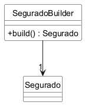

# Builder

Trabalho da disciplina Aspectos Avançados em Engenharia de Software.

Exemplo do padrão Builder em Java, com testes em JUnit 5. O tema é o mesmo da
seguradora usada nos trabalhos anteriores: o cadastro do segurado tem muitos
campos (nome, CPF, RG, data de nascimento, profissão, endereço, e-mail e
celular), mas só o CPF e o nome são obrigatórios.

O `SeguradoBuilder` monta o segurado aos poucos, um campo de cada vez, e só no
`build()` confere se o CPF e o nome foram preenchidos. Assim não precisa de um
construtor gigante com todos os campos.

## Diagrama de classes

